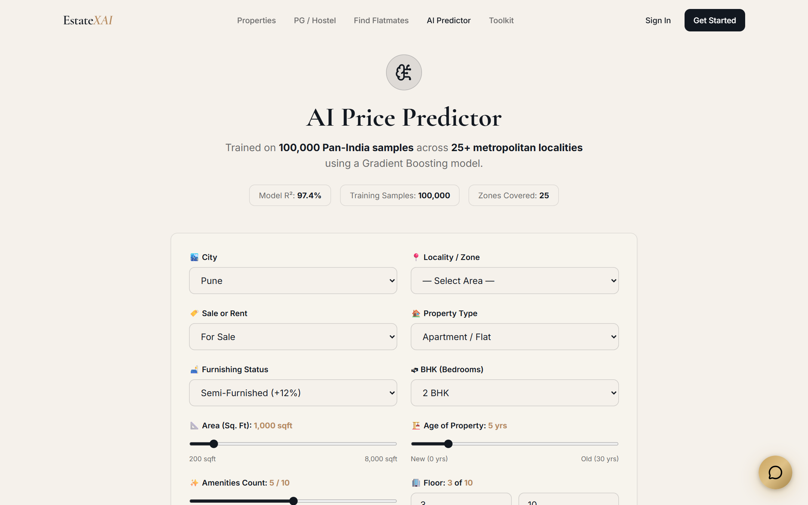
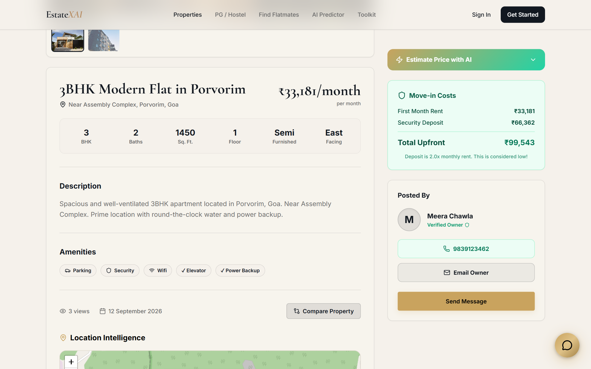
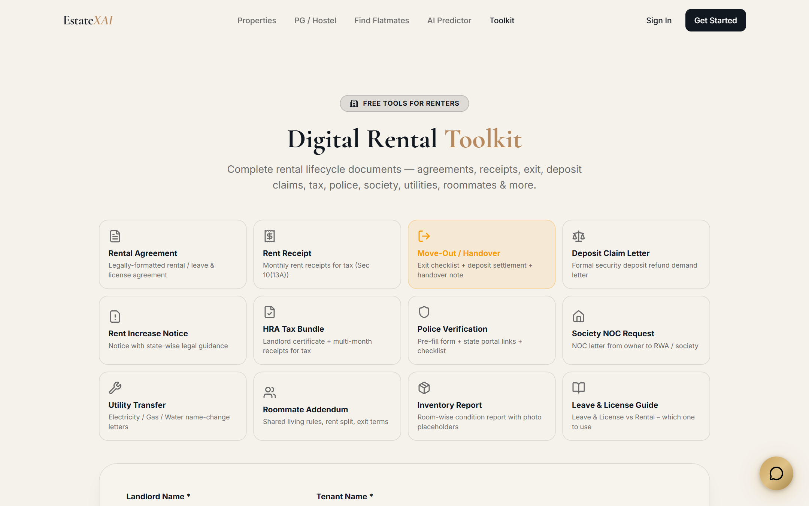
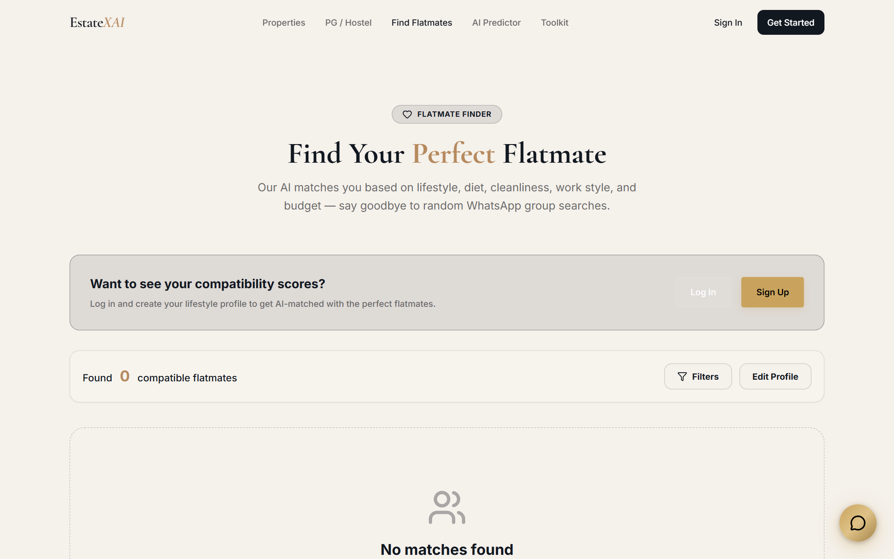

# EstateXAI 🏠✨
### AI-Driven Real Estate, Co-Living & PG/Hostel Intelligence Platform

[](https://estate-xai.vercel.app/)
[](https://estatexai.onrender.com)
[](https://github.com/ayush0121n/estateXAI)
[](https://opensource.org/licenses/MIT)

**Live Web Application:** [https://estate-xai.vercel.app/](https://estate-xai.vercel.app/)  
**Live Backend API:** [https://estatexai.onrender.com](https://estatexai.onrender.com)  
**Interactive API Documentation (Swagger):** [https://estatexai.onrender.com/api/docs](https://estatexai.onrender.com/api/docs)

EstateXAI is an enterprise-grade full-stack real estate and co-living platform built on the MERN stack and Python Scikit-Learn microservice. Designed to solve real-world rental and buying challenges, EstateXAI features a hybrid recommendation engine, an AI price prediction regressor (with dual-engine fallback), an interactive 8-domain problem-solving AI Chatbot, automated geocoding with CartoDB Voyager location intelligence, and a digital rental toolkit.

---

## 📸 Platform Highlights & Screenshots

| AI Chatbot & Price Estimation | Location Intelligence & CartoDB Map |
|---|---|
|  |  |

| Digital Rental Toolkit (PDF Export) | Roommate Compatibility Matcher |
|---|---|
|  |  |

---

## 🌟 Flagship Features

### 1. 🤖 EstateXAI Assistant — Problem-Solving AI Chatbot
An omni-present AI assistant accessible across the entire application via a floating widget and home showcase:
- **Price Fairness & Negotiation:** Evaluates user offers against local historical trends with actionable negotiation leverage.
- **Hidden Cost Calculator:** Computes stamp duty, registration fees, GST, security deposits, and brokerage.
- **Lease & Legal Clarity:** Explains standard 11-month lease clauses, lock-in terms, and tenant rights.
- **Commute & Location Scorer:** Measures transit times to major IT corridors (Hinjawadi, Magarpatta, Kharadi, Cyber City).
- **Roommate Conflict Solver:** Actionable dispute mediation for chores, late utility bills, and guest policies.
- **Deposit Recovery Strategies:** Provides legal notice templates and step-by-step procedures for recovering withheld deposits.
- **Natural Language Discovery:** Search properties and PGs by conversational criteria (budget, location, sharing).
- **Maintenance & Dispute Resolution:** Immediate clarity on landlord vs. tenant repair obligations.

### 2. 🗺️ Location Intelligence & CartoDB Voyager Maps
- **Reliable CartoDB Voyager Tiles:** High-performance, CDN-cached vector raster tiles that never fail or show empty gray boxes.
- **Silent Geocoding:** Auto-converts text addresses into exact Latitude/Longitude coordinates upon property creation via Nominatim.
- **Nearby POIs & Scores:** Dynamic Walkability Score (0-100) and Connectivity Score computed from schools, transit, hospitals, and parks.
- **Street View & Maps Integration:** Direct deep links to Google Street View and Google Maps navigation.

### 3. 📑 Digital Rental Toolkit & Lifecycle Suite
- **Interactive Lease Agreement Generator:** Generates legally structured 11-month residential lease agreements populated with tenant/landlord specifics.
- **HRA Rent Receipts:** Generates monthly/quarterly rent receipts complete with revenue stamp formatting, transaction IDs, and landlord PAN fields.
- **Client-Side PDF Export:** Instant high-resolution print and download powered by `jsPDF`.

### 4. 📈 Real Estate Price Prediction & CMA
- **Model:** Random Forest Regressor ($n=200$, $\text{max\_depth}=20$) with **82.92% $R^2$ accuracy**.
- **Comparative Market Analysis (CMA):** Interactive Recharts graph comparing listing prices against predicted fair value and 80% confidence intervals.
- **Dual-Engine Resilience:** Automatic fallback to embedded pure-JS inference (`jsPricePredictor.js`) if the Python microservice is sleeping.

### 5. 🎯 Hybrid Recommendation Engine
- **Content-Based Filtering:** Vector cosine similarity across BHK, price, amenities, and property type.
- **Collaborative Filtering:** Item-based similarity leveraging real-time user interaction graph (views, bookmarks, inquiries).
- **Formula:** Weighted scoring ($0.6 \times \text{Content} + 0.4 \times \text{Collaborative}$) with cold-start fallback.

### 6. 🤝 Roommate Compatibility Matcher
- **Lifestyle Alignment:** Matches users by schedule, dietary habits, smoking/drinking, cleanliness, and WFH habits.
- **Direct Connect:** Instant encrypted contact via WhatsApp and email.

---

## 🔑 Demo Credentials

| Role | Email | Password | Permissions & Capabilities |
|------|-------|----------|----------------------------|
| **Admin** | `admin@estatexai.com` | `Admin@123` | Listing moderation (approve/reject), system config, user management, analytics |
| **Owner** | `owner@estatexai.com` | `Owner@123` | Create listings, image uploads, lead inquiry tracking, property performance |
| **Tenant** | `tenant@estatexai.com` | `Tenant@123` | Roommate questionnaire, saved favorites, property comparisons, rental toolkit |

---

## 🚀 Getting Started Locally

### Prerequisites
- Node.js v18+ (Node v20 or v22 recommended)
- Python 3.10+ (for optional Python ML service)
- MongoDB Atlas cluster or local MongoDB instance

### 1. Clone the Repository
```bash
git clone https://github.com/ayush0121n/estateXAI.git
cd estateXAI
```

### 2. Backend Setup
```bash
cd backend
npm install
# Configure .env with MONGO_URI, JWT_SECRET, PORT=5000
npm run dev
# Server runs on http://localhost:5000
```

### 3. Database Seeding (Sample Properties, PGs, Users, Reviews)
```bash
cd backend
node scripts/seed.js
```

### 4. ML Microservice (Optional)
> The backend automatically falls back to its built-in JavaScript Random Forest engine with 82.9% accuracy when Python microservice is not active!
```bash
cd backend/ml_service
pip install -r requirements.txt
python train_model.py
uvicorn app:app --port 8001 --reload
```

### 5. Frontend Setup
```bash
cd frontend
npm install
npm run dev
# App runs on http://localhost:5173
```

---

## ⚙️ REST API Endpoints

### Authentication & Profiles
| Method | Endpoint | Description | Access |
|--------|----------|-------------|--------|
| `POST` | `/api/auth/register` | Register new user account with role selection | Public |
| `POST` | `/api/auth/login` | Authenticate user and issue 7-day JWT token | Public |
| `GET` | `/api/user/profile` | Retrieve user profile, preferences, and saved items | Authenticated |
| `PUT` | `/api/user/profile` | Update user lifestyle questionnaire and bio | Authenticated |

### Listings & Search
| Method | Endpoint | Description | Access |
|--------|----------|-------------|--------|
| `GET` | `/api/properties` | Filtered property listings with pagination & sorting | Public |
| `GET` | `/api/properties/:id` | Property detail view (logs user interaction) | Public |
| `POST` | `/api/properties` | Create property listing with auto-geocoding & image upload | Owner / Admin |
| `PATCH` | `/api/properties/:id/approve`| Admin review & moderation workflow | Admin |
| `GET` | `/api/pgs` | Filtered PG / Co-living listings with sharing filters | Public |
| `GET` | `/api/search` | Unified global full-text search across all inventories | Public |

### AI, Chatbot & Recommendations
| Method | Endpoint | Description | Access |
|--------|----------|-------------|--------|
| `POST` | `/api/chat` | EstateXAI Assistant 8-domain real-world AI reasoning | Public |
| `POST` | `/api/predict-price` | AI Price Prediction Regressor (FastAPI + JS fallback) | Public |
| `GET` | `/api/recommendations/properties`| Hybrid personalized property recommendations | Authenticated |
| `GET` | `/api/recommendations/pgs` | Hybrid personalized PG recommendations | Authenticated |

### Admin & Analytics
| Method | Endpoint | Description | Access |
|--------|----------|-------------|--------|
| `GET` | `/api/admin/analytics` | Platform metrics, listing distribution, traffic trends | Admin |
| `GET` | `/api/admin/moderation` | Moderation backlog for pending listings | Admin |
| `GET` | `/api/docs` | Interactive Swagger / OpenAPI documentation UI | Public |

---

## 🧪 Automated Testing & QA

EstateXAI maintains a comprehensive integration test suite with Jest and Supertest against an isolated in-memory MongoDB instance:

```bash
cd backend
npm test
```

```
PASS tests/api.test.js
  Health & Core Endpoints (3 tests)
  Auth Routes (5 tests)
  Property Endpoints (5 tests)
  PG Endpoints (4 tests)
  Price Prediction Route (4 tests)
  Search Endpoints (2 tests)
  Chat (EstateXAI Assistant) Route (7 tests)
  Commute Routes (2 tests)
  Neighborhood Routes (2 tests)

Test Suites: 1 passed, 1 total
Tests:       34 passed, 34 total
Snapshots:   0 total
Time:        9.4 s
```

---

## 🎨 Tech Stack Matrix

| Domain | Technology / Library | Purpose & Rationale |
|---|---|---|
| **Frontend Framework** | React 18 + Vite | Blazing fast client bundle with hot module replacement |
| **Routing & Navigation** | React Router DOM v7 | Dynamic nested routes, protected role layouts |
| **UI & Styling** | Vanilla CSS + Glassmorphism | Custom design tokens, dark theme, responsive layouts |
| **Animation** | Framer Motion | Fluid micro-interactions, modal popups, floating widgets |
| **Data Visualization** | Recharts | Comparative Market Analysis (CMA) and admin dashboards |
| **Mapping Engine** | Leaflet + CartoDB Voyager | Reliable geospatial discovery with zero tile failure |
| **PDF Generation** | jsPDF | Client-side dynamic export for leases and rent receipts |
| **Backend Framework** | Node.js + Express 4 | High-performance asynchronous REST API |
| **Database & ODM** | MongoDB Atlas + Mongoose 9 | Scalable document data store with compound indexing |
| **Authentication** | JWT + bcryptjs | Secure stateless token authentication and password hashing |
| **Documentation** | Swagger UI + swagger-jsdoc | OpenAPI 3.0 interactive API documentation |
| **ML Microservice** | Python 3.10+ / FastAPI | Scikit-Learn Random Forest Regressor with 82.9% R² score |
| **Testing** | Jest + Supertest | 34 automated unit and integration tests |
| **Deployments** | Vercel (Front) & Render (Back)| Automated continuous deployment |

---

## 📄 Comprehensive Project Reports

The complete, university-formatted project documentation is included directly in the repository:
- **Microsoft Word Document:** [`estateXAI_Project_Report.docx`](./estateXAI_Project_Report.docx) (12 MB)
- **Adobe PDF Document:** [`estateXAI_Project_Report.pdf`](./estateXAI_Project_Report.pdf) (3.1 MB)

---

## 👥 Authors & Acknowledgements
- **Lead Developer:** Ayush Nandwana ([@ayush0121n](https://github.com/ayush0121n))
- **Project Repository:** [https://github.com/ayush0121n/estateXAI](https://github.com/ayush0121n/estateXAI)

Licensed under the [MIT License](./LICENSE).
